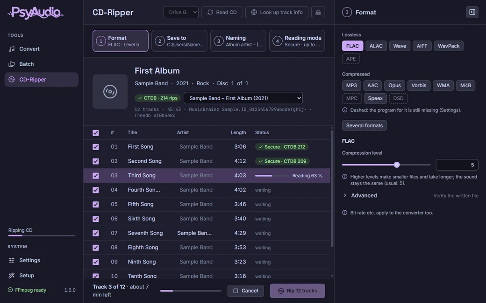

<h1>
  <picture>
    <source media="(prefers-color-scheme: dark)" srcset="assets/PsyAudio-wordmark.png">
    
  </picture>
</h1>

Audio toolbox for Windows, Linux and macOS: a **bit-perfect CD ripper**, a converter and a batch converter, in one window.

## Download

Installer for Windows, AppImage, deb and rpm for Linux and a disk image for macOS are on the [releases page](https://github.com/Psychotoxical/PsyAudio/releases). What changed in each version is in the [changelog](CHANGELOG.md).

## Bit-perfect CD rips

PsyAudio rips a CD so that every file holds exactly the samples on the disc, and it proves it track by track.

- **Verified against the CUETools database (CTDB).** Every track is compared with the checksums of other people's rips of the same disc. A confirmed track is identical, sample for sample, to what they got. The CD header shows how many rips the database knows and links to the disc's entry, so anyone can check.
- **Drive offset measured for you.** Every CD drive reads a tiny bit shifted. PsyAudio measures the shift once with any bought audio CD that is in the database (almost every one is), keeps it per drive and corrects it in every rip. The first-start setup offers the measurement; without a CD at hand, PsyAudio measures on its own the first time it reads one.
- **Secure reading that stays fast.** Each track is read in one go. When the database confirms it, the track is done; otherwise a second pass follows and only the spots that differ are read again, until two reads agree. Before a re-read, PsyAudio reads past the drive's buffer (it asks the drive how large it is), so the spot really comes from the disc and not from the drive's memory.
- **Nothing hidden.** A log with the checksums and the database result, a CUE sheet, cover art and tags from MusicBrainz and the Cover Art Archive go into the album folder. A track that could not be confirmed is marked as such, never passed off as good.
- **Any format at once.** Rip to FLAC, ALAC, WAV, AIFF, WavPack, MP3, AAC, Opus and more, or to several formats in one go.

The CUETools database is open: its data is public domain, and lookups need no account or key.

## Converter and batch converter

- MP3, FLAC, AAC, ALAC, Opus, Vorbis, WavPack, WMA, Speex, WAV, AIFF, Monkey's Audio, Musepack and DSD.
- About 35 effects, ReplayGain and EBU R128 loudness, tags and covers carried over, file and folder names built from tags.
- The batch converter converts a whole folder tree and keeps its structure.
- "Convert with PsyAudio" in the right-click menu of the Explorer (Windows) or Dolphin (Linux).
- Catppuccin Mocha (dark) and Latte (light), English and German.

## Build and run

| Task | Command |
|---|---|
| Install | `npm ci` |
| Run with live reload | `npm run tauri dev` (starts Vite on port 1420 and the window) |
| Debug build without Vite | `npx tauri build --debug --no-bundle` (frontend embedded, `target/debug/PsyAudio.exe`) |
| Frontend checks | `npm run check` (Biome and TypeScript), `npm test` (Vitest) |
| Rust checks | `cargo fmt --all -- --check`, `cargo clippy --workspace --all-targets -- -D warnings`, `cargo test --workspace` |

`cargo test` includes a real conversion into several formats and needs FFmpeg on the `PATH`. It also writes the TypeScript types of the settings into `src/ipc/bindings` (ts-rs); CI fails when they differ from the committed files.

Settings are stored in `%APPDATA%\PsyAudio\settings.json` (Linux: `~/.config/PsyAudio/settings.json`, macOS: `~/Library/Application Support/PsyAudio/settings.json`).

## Sample mode and screenshots

`PsyAudio --demo=<konverter|stapel|cd|einstellungen|einrichtung> [--light] [--en]` opens a page with made-up sample content, in German unless `--en`, dark unless `--light`. Nothing is saved and no other PsyAudio window is asked. Any other page name opens the converter without sample files, which is handy for test runs with files passed on the command line.

`node scripts/capture.mjs <page> <file.png> [options]` starts the debug build in sample mode and saves a screenshot through the WebView2 DevTools protocol (Windows). Options, run in order: `--light`, `--en`, `--file=<path>`, `--click=<css>`, `--eval=<js>`, `--wait=<css>`, `--close` (the window's close button), `--expect-exit`, `--title`.

`assets/screenshots.webp` is made from five such screenshots (1280 × 800, English) with FFmpeg: `xfade` between them, encoded with `libwebp_anim` from `bgra` frames (a `yuv420p` input pales the colours). The setup page and the drive box show this computer's drives; check every picture for paths and device names before it goes into the repository.

## External programs

- WAV and AIFF are written by PsyAudio itself; decoding uses `symphonia`.
- MP3, FLAC, AAC, ALAC, Opus, Vorbis, WavPack, WMA and Speex go through the **FFmpeg command line**: PCM is piped in on stdin (`encode::run_ffmpeg`). Formats `symphonia` cannot read are decoded by FFmpeg as well.
- Monkey's Audio, Musepack and DSD need `mac`, `mpcenc` and `sox`; their paths are set on the settings page.
- HDCD decoding uses FFmpeg's `hdcd` filter.

## Layout

| Folder | Contents |
|---|---|
| `crates/core` | `psyaudio-core`: everything except the window (conversion, effects, tags, naming, CD ripping, settings, translation) |
| `src-tauri` | The Tauri app: commands (`*_cmd.rs`), background work (`jobs.rs`, `run_cmd.rs`), close guard (`close.rs`), single instance, drag and drop |
| `src` | The React frontend: `shell/` (sidebar, step tiles, side column), `pages/` (convert, batch, cd, settings, setup), `ui/` (controls), `store/` (zustand), `ipc/` (commands and generated types) |
| `tools` | `i18n_dict.tsv` and its generator |
| `scripts` | `capture.mjs` |

### Core (`crates/core/src/`)

| File | Contents |
|---|---|
| `settings.rs` | `Settings`, `RipSettings`, `UiState` (serde, `#[serde(default)]`), profiles, load, salvage and save, reset |
| `convert.rs` | Conversion pipeline: `Plan`, `Job`, thread pool, `run_job` (decode → effects → encode → tags), album ReplayGain, playlists |
| `audio.rs` | `Audio` (interleaved f32), decoding with symphonia or FFmpeg, ffprobe, size and time formatting |
| `encode.rs` | `Codec`, `EncSettings`, FFmpeg arguments per format, external encoders, lossless verification, size estimate |
| `dsp.rs` | About 35 effects (`Effect`, `catalogue()`, `catalogue_entries()` with a description each, `apply()`) |
| `loudness.rs` | EBU R128 and ReplayGain (−18 LUFS) |
| `naming.rs` | Folder and file names built from chips, naming presets |
| `tags.rs` | Reading and writing tags with `lofty` |
| `files.rs` | Adding files and folders, existing targets |
| `rip.rs` | The rip worker: statuses (`TrackStatus`, `CtdbResult`, `RipPhase`, `RipSummary`) as codes, log, CUE, folder.jpg |
| `cdrip.rs` | CD: TOC (Windows IOCTL, Linux CD-ROM ioctls, macOS CD-DA ioctls), drive model, freedb and MusicBrainz disc IDs, MusicBrainz and Cover Art Archive lookups, eject |
| `ctdb.rs` | CUETools database (CTDB): lookup, track checksums, disc page, rolling CRC32 and the drive offset search |
| `cdrip_read.rs` | Secure reading: passes, re-reads, cache flushing, interpolation |
| `scsi.rs` | Raw SCSI commands to the drive (Windows pass-through, Linux SG_IO, macOS SCSITaskLib through `macos_scsi.c`): buffer size, cache flush size, stopping the disc (not on macOS) |
| `integration.rs` | Explorer (per extension) and Dolphin context menu, keeping the computer awake |
| `i18n.rs` / `i18n_dict.rs` | Translation; `i18n_dict.rs` is generated |
| `timefmt.rs` | Durations and encoding speed in words |

## Commands

Every command the frontend may call is listed in `src-tauri/build.rs` (`COMMANDS`) and granted in `src-tauri/capabilities/main.json` (`allow-…`). A new command needs both entries. Long work (converting, ripping, the offset search, MusicBrainz) runs in threads and reports through Tauri channels; statuses travel as codes and are worded in the frontend.

## Translation

- Visible texts are written in **German** and the German text is the key, in Rust (`i18n::t("…")`, `tf(…)`) and in the frontend (`t("…")`, placeholders `{name}`).
- English lives in `tools/i18n_dict.tsv` (German, tab, English). Regenerate both tables with `python -I tools/i18n_gen.py tools/i18n_dict.tsv crates/core/src/i18n_dict.rs src/locales/en.json`.
- Tests check that every `t("…")` of the frontend has an English entry and that translations keep the `{…}` placeholders.

## Conventions

- Code comments are in English.
- Colours come from the Catppuccin tokens in `src/styles/tokens.css` (Mocha and Latte, accent Mauve); a test checks text contrast.
- Every option in a side column gets a one-line hint; units sit inside the value field ("192 kbit/s").
